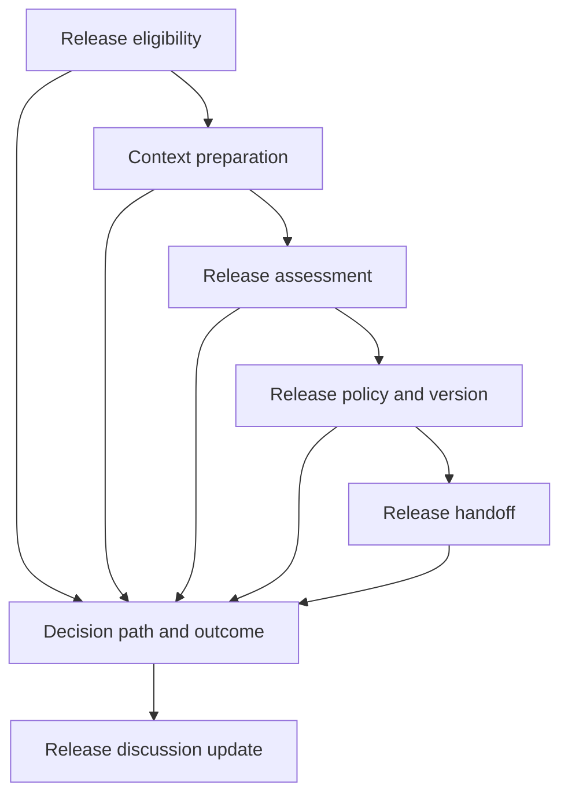
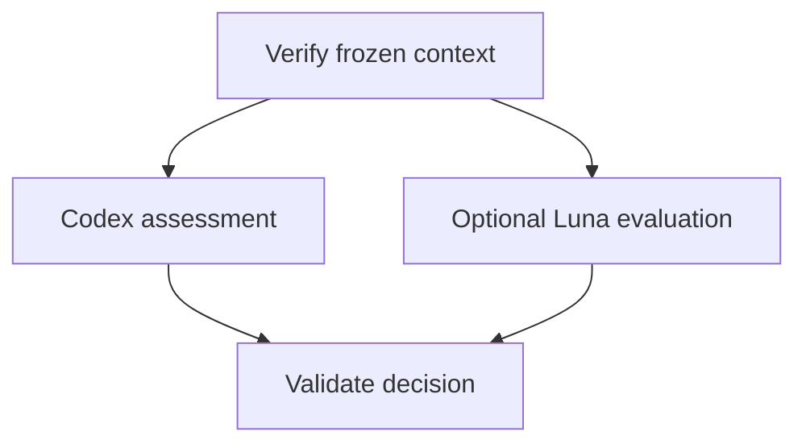

# Release assessment and decision path

The scheduler uses the official [Codex GitHub Action](https://github.com/openai/codex-action)
for its release assessment. Deterministic code controls eligibility, validates the
structured decision, computes the version, and authorizes an exact-commit handoff.
Luna 6 Decisions is an optional comparison through the official
[OpenAI Python SDK](https://github.com/openai/openai-python). Its recommendation,
confidence and availability never authorize or veto a release.

The change replaces the old custom OpenAI HTTP preflight, transport, retry,
request-compaction and response-parser paths. It retains the existing biweekly
cadence, opt-in scheduling, manual dry-run default, and preparation/publication
freeze, validation receipts and durable checkpoints. It does not activate
`RELEASE_SCHEDULER_ENABLED` or `RELEASE_DIRECT_PUSH`.

## Visible Actions graph

Each stage below is a job with named steps. Expanding **Release assessment** shows
its context verification, Codex, optional Luna, and decision-validation jobs.

The outcome job runs after successful, failed and skipped branches. Its table
answers which stages ran, why eligibility stopped, what was recommended, whether
preparation was dispatched, and where to investigate. A successful dispatch is
not a completed release; preparation and publication retain their own graphs.

## Eligibility and authority

Before spending model tokens, the scheduler requires the workflow candidate to be
the current default-branch commit, a supported snapshot version, a reachable
release baseline, binary-impacting changes, and successful canonical push CI on
that exact commit. It checks the latest CI attempt, open release PRs, release
freezes and incomplete durable publication records. A scheduled run must also be
in its biweekly window. A manual run bypasses cadence, not the safety checks.

Eligibility records fixed reason codes in `context.json`. It does not ask the
model to infer CI success, deployment state, branch freshness or version validity.
An ongoing release must be resumed or reconciled before assessing another one.

The model must return exactly one of these decisions:

| Decision | Meaning | Allowed bump | Handoff |
|---|---|---|---|
| `release` | Sufficient evidence justifies releasing now | `patch` or `minor` | Only after validation |
| `defer` | Evidence is adequate, but a release is not justified | `none` | Skipped |
| `insufficient_evidence` | A material fact is missing | `none` | Skipped |

A release requires the exact source SHA, a bounded reason, concrete evidence,
empty `blocking_risks` and `missing_evidence` lists, and satisfied deterministic
preconditions. Unknown fields, duplicate JSON keys, malformed types, contradictory
decisions, unsupported bumps and source mismatches fail closed. No confidence
threshold is used. Major versions require human review; an ahead POM cannot
silently convert an assessed patch into a minor or major release.

An unavailable or invalid assessor is an operational failure, not a `defer`
decision. Even plausible JSON cannot authorize a handoff after its Codex job
failed. The validation result and final summary remain available for diagnosis.
Luna failures, including setup failures, remain advisory.

Immediately before dispatch, the controller rechecks the candidate and CI/lifecycle
state. It passes `sourceSha`, `releaseVersion` and `dryRun` to `prepare-release.yml`.
Preparation requires the assessed SHA to match the trusted dispatched workflow
revision and the current default branch before acquiring a freeze, then checks
it again before mutation. Branch movement requires a new assessment.

## Evidence quality

`context.json` contains policy, candidate identity, annotated release-tag date,
POM version, cadence, CI identity, metrics and deterministic preconditions.
`release-dossier.md` contains categorized paths, changelog, API/Javadoc/test
signals and selected diffs. SHA-256 digests bind both to the candidate in
`release-assessment-manifest.json`.

Diffs are collected in actual production-first category order. Weighted category
budgets and per-file limits prevent a large workflow or source file from consuming
all evidence. Coverage records distinguish available, included, omitted and
truncated files/bytes. API and Javadoc signals are collected before excerpting,
with their own documented bound. Public paths, Java identifiers, URLs and commit
IDs remain readable; recognizable credentials and private keys are redacted.

Codex can inspect the exact candidate and release baseline in an isolated read-only
workspace to investigate omitted excerpts. Repository text remains untrusted
evidence. It is never an instruction to publish, run builds, access the network
or reveal credentials. Luna receives the same frozen policy and selected dossier
without tools. That difference matters when comparing their recommendations.

The scheduler gives selected diffs a 160,000-byte budget. The full dossier also
contains path inventories and other signals. Before a Decisions request, the SDK
adapter enforces the API's 256 KiB typed-input, 10,000-value and 32-level limits.
Oversize evidence is explicitly unavailable for comparison; it is not silently
truncated again or sent as an oversized request.

## Configuration and manual use

| Setting | Default | Purpose |
|---|---|---|
| `RELEASE_SCHEDULER_ENABLED` | Existing value | Scheduled runs require `true` |
| `RELEASE_SCHEDULER_RUNNER` | `["ubuntu-latest"]` | Scheduler runner labels as JSON |
| `RELEASE_ASSESSMENT_RUNNER` | Scheduler runner choice | Separate model-runner placement |
| `RELEASE_ASSESSMENT_MODEL` | `gpt-6.1-sol` | Explicit primary Codex model |
| `RELEASE_ASSESSMENT_USER` | Empty | Dedicated account required on self-hosted model runners |
| `RELEASE_LUNA_EVALUATION_ENABLED` | Disabled | Enable optional comparison for scheduled runs |
| `OPENAI_API_KEY` secret | Existing secret | Authentication for the official action/SDK |
| `RELEASE_SCHEDULER_DISCUSSION_NUMBER` | `1414` | Existing outcome discussion |

For deterministic diagnostics without a model charge, dispatch with `aiMode=skip`.
For a complete assessment, use `aiMode=full` and `dryRun=true`; this still incurs
the primary model charge. A validated release recommendation dispatches preparation
in dry-run mode. Enable `evaluateLuna=true` for an additional comparison call;
the repository comparison variable can also enable it. `dryRun=false` explicitly
permits the existing preparation path. The old HTTP-only `probe` mode and
`RELEASE_AI_MAX_REQUEST_BYTES` setting are retired.

The action, CLI and SDK are pinned in source. Changing a model is configuration,
not evidence of higher decision quality. Compare representative releases,
deferrals, risky changes and incomplete evidence against maintainer judgments
before changing authority. Agreement measures consistency; a provider's returned
confidence is not a calibrated correctness probability for TA4J.

## Runner isolation and reuse

GitHub-hosted model jobs use the official action's `drop-sudo` strategy and
read-only permission profile. Self-hosted jobs use `unprivileged-user`, which
requires an explicitly preprovisioned account with no sudo, a clean dedicated
home, and executable Node/Codex runtime paths. The runner account must already
have traversal access through the service account's home, because the official
action starts and reads its proxy as the runner. Setup verifies that access and
that the prepared proxy-info file is readable and writable by the runner; it
fails before the model action if either is unavailable. It does not loosen the
home directory's permissions. The setup locks the account for the run and cleans
only state it created. It does not
remove the persistent runner's sudo privileges or inherit an existing Codex
configuration. Failed cleanup/abandoned locks need operator investigation.

The caller chooses JSON runner labels; the workflow does not require a vendor
specific runner service. Linux is the supported scheduler environment because
the existing dossier helper uses its shell utilities. The reusable assessor is
POSIX-oriented; macOS and persistent self-hosted operation need an environment
smoke test before production use. Windows runners are not supported by this
configuration. Required tooling is Git, Bash, Python, Node/npm, the action's sudo
capabilities and outbound access to GitHub/action dependencies and OpenAI.

Model jobs receive read permissions and the model credential, with no release
or deployment credentials. A read-only filesystem alone is not credential
isolation: the action's privilege separation is required. Candidate contents are
copied into a separate workspace without inheriting candidate Git/Codex settings.
Use trusted, pinned framework code; never execute a PR's proposed workflow with
release credentials.

Call the reusable workflow with `source_sha` and `evidence_artifact`. Optional
`evidence_run_id` selects a producer run in the caller repository. Cross-repository
callers pin the workflow to a reviewed immutable commit and supply the schema-2
context, dossier and manifest. Framework scripts always come from that called
workflow's own `job.workflow_repository` and `job.workflow_sha`; callers cannot
replace controller code through candidate or framework inputs. The candidate is
checked out separately and used only as assessment data. These native
[workflow identity fields](https://docs.github.com/en/actions/reference/workflows-and-actions/contexts#job-context)
require GitHub.com and are unavailable on GitHub Enterprise Server; missing
identity fails before framework checkout, without falling back to caller code.
Its outputs are `recommendation`, `should_release`, `bump` and `all_agree`; an
empty agreement means the results are not comparable.

## Output contract: why each item exists

Console output is status-oriented. Human explanations are written once in job
summaries; bounded evidence is retained in explicitly listed artifacts for 14 days.
No raw request/response, HTTP headers, complete prompt, environment dump, shell
trace, reasoning transcript or broad workspace glob is intentionally uploaded.

| Output | Reason it exists |
|---|---|
| `audit:eligibility` | Explains whether the model stage can run, with count and fixed blocker codes |
| `audit:release_dossier` | Confirms evidence volume and whether sampling omitted material |
| `audit:assessment_runtime` | Identifies the enforced privilege isolation strategy |
| `audit:assessment` | Records the validated authority result and handoff eligibility |
| `audit:luna` | Distinguishes completed, refused and unavailable optional evaluation |
| `audit:release_plan` | Identifies the validated version and dry-run mode |
| `audit:release_handoff` | Distinguishes new dispatch from an already-dispatched preparation |
| Preparation's source audit | Lets maintainers match prepared and assessed commits |
| Validation errors | Identify the failed invariant without dumping untrusted/provider content |
| Job outputs | Carry only routing flags, source/version identity and reusable result fields consumed by dependencies |
| Eligibility/evidence artifacts | Make the exact policy, source, coverage and evidence reproducible |
| Provider/result artifacts | Preserve bounded rationale, concrete evidence, blockers and comparison usage/latency |
| Release-plan artifact | Records exactly what the controller authorized for preparation |
| Outcome summary/artifact | Explains the complete decision path and recovery action |
| Discussion update | Links the real due run's outcome; skipped/dry/off-cadence runs do not post |

Official actions also emit their own lifecycle/install/error diagnostics. Those
lines are upstream-owned: the Codex action has no quiet option. JSON mode avoids
its default full prompt/configuration banner; reasoning summaries are disabled,
color is disabled, and npm funding/audit/progress chatter is disabled. Selected
tool output, final structured decision, lifecycle and usage events remain useful
for diagnosing the action and are the explicit accepted logging boundary. Adding
a custom wrapper or action fork solely to suppress those lines would undermine
the official-action migration.

## Validation and rollout

Run `bash scripts/run-script-checks.sh`. It includes actionlint and isolated
fixtures for schema/refusal/provider failures, evidence corruption, input bounds,
runtime isolation, evidence coverage/redaction, cadence, version planning,
exact-source CI, freshness, deduplication and preparation handoff. Network and
model calls are mocked; Maven is not part of this script-only change.

Before enabling scheduling on a newly configured runner, use a default-branch
dry run to verify its OpenAI access and action runtime, then optionally collect
Luna comparisons. This repository change does not itself enable production
variables or perform a live publication. When a model fails, inspect the named
stage and result artifact before repeating a billed run. When preparation fails,
use its existing freeze/publication checkpoints rather than starting another
release blindly.
